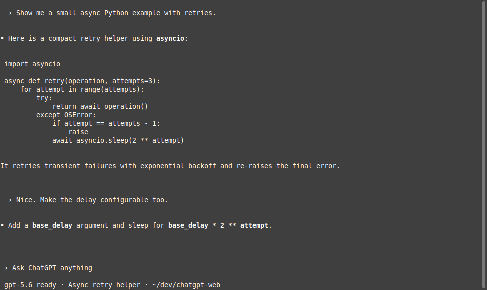
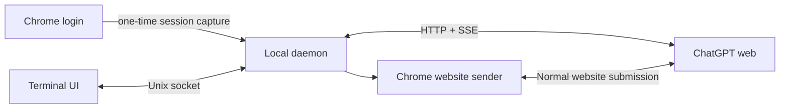

# 🌸 chatgpt-web

> A fast, Codex-inspired terminal client for your ChatGPT conversations.

`chatgpt-web` connects to an authenticated ChatGPT web session and brings it to
the terminal: streaming answers, searchable history, Markdown rendering,
syntax-highlighted code, native scrollback, and a bottom composer that feels at
home beside modern coding agents.

<p align="center">
  
</p>

> [!IMPORTANT]
> This is an experimental, unofficial client for undocumented ChatGPT web
> endpoints. It may stop working when the web application changes. It is not an
> OpenAI API client and is not affiliated with or endorsed by OpenAI.

## ✨ Highlights

- 🖥️ **Codex-style terminal UI** with a full viewport and bottom composer
- ⚡ **Streaming responses** with responsive input while generation continues
- 🔎 **Searchable resume picker** for recent conversations
- 🧠 **Persistent authentication** after a one-time interactive Chrome login
- 💾 **Offline startup restore** from an atomic local conversation snapshot
- 🚀 **Browser-backed sending** through the authenticated website
- 🎨 **Rich Markdown** with syntax-highlighted fenced code blocks
- 🖼️ **Clipboard images** uploaded and attached directly from the composer
- 📜 **Native terminal scrollback** bounded to the current session
- ↔️ **Resize-aware history** that reflows completed turns to the new width
- 🧹 **Clean history rendering** that hides internal tool-protocol payloads
- 📋 **Clipboard support** through `/copy`
- 🪶 **Zero manual environment setup** when launched with `uv`

## 🚦 Quick start

### Requirements

- Python 3.10+
- [`uv`](https://docs.astral.sh/uv/) (recommended), or `pip`
- Node.js 22+
- Chrome or Chromium for login and default sending
- `wl-paste` (Wayland), `xclip` (X11), or `pngpaste` (macOS) for image paste

```bash
git clone https://github.com/tritao/chatgpt-web.git
cd chatgpt-web

# Open a dedicated Chrome profile and log in to ChatGPT.
./run login

# Capture the authenticated session, then launch the terminal UI.
./run auth
./run
```

The default sender uses the authenticated ChatGPT website in Chrome. Keep its
ChatGPT tab available; the client starts the dedicated browser if it is stopped.
Complete login or any interactive challenge there when requested. Conversation
reads and offline restoration use the saved session and local cache.

The client caches each loaded or completed conversation under
`$XDG_DATA_HOME/chatgpt-web/conversations` (normally
`~/.local/share/chatgpt-web/conversations`). Reopening the terminal UI restores
the last active conversation directly from that cache without starting the
daemon or contacting ChatGPT. Network access begins only when you send a
message or use a command that requests server data, such as `/resume` or
`/history`. `/new` clears the active-conversation pointer.

This also makes Sakura workspace restoration offline: Sakura already restores
its ChatGPT tool tab by relaunching `chatgpt-web`, which now immediately replays
the cached conversation.

To make the command available everywhere:

```bash
mkdir -p ~/.local/bin
ln -s "$(pwd)/run" ~/.local/bin/chatgpt-web
```

## 🎮 Terminal controls

| Key | Action |
| --- | --- |
| `Enter` | Send the prompt |
| `Alt+Enter` | Insert a newline |
| `Ctrl+R` | Open the searchable conversation picker |
| `Ctrl+V` | Attach a PNG image from the clipboard |
| `Ctrl+C` | Clear the prompt, or stop an active response |
| `Ctrl+D` | Exit from an empty prompt |
| `PageUp` / `PageDown` | Move through the transcript |
| Mouse wheel | Scroll the terminal's conversation history |
| `Home` / `End` | Move to the start or end of the current prompt line |
| `End` outside the prompt | Follow new output at the bottom |
| `Tab` / `Enter` | Accept a slash-command completion |
| `Escape` | Close autocomplete or the resume picker |

Type `/` to open command completion:

| Command | Action |
| --- | --- |
| `/new` | Start a new conversation |
| `/resume` | Search recent conversations |
| `/resume ID` | Open a conversation directly |
| `/history` | Reload the current conversation |
| `/rename TITLE` | Rename the current conversation |
| `/copy` | Copy the latest assistant response |
| `/remove` | Remove the latest pending image |
| `/clear` | Clear the displayed transcript |
| `/help` | Show command help |
| `/exit`, `/quit` | Exit the client |

## 🧰 Command-line usage

The same session can be used without the interactive UI:

```bash
./run list
./run list --limit 100
./run list --all --output jsonl
./run show CONVERSATION_ID
./run rename CONVERSATION_ID "New title"
./run new "Explain monads in one paragraph"
./run send CONVERSATION_ID "Continue with an example"
./run resume CONVERSATION_ID
./run status
./run stop
./run logout
```

## 🏗️ How it works



1. `login` starts Chrome with a dedicated, persistent profile.
2. `auth` captures the authenticated browser session through local Chrome
   DevTools Protocol and stores it in a mode-`0600` state file.
3. A local daemon serves CLI invocations through a mode-`0600` Unix socket.
4. Python performs conversation reads and caches history independently of sending.
5. The default Node sender submits through the website and streams visible output,
   leaving challenge handling to the website. It shares draft-preserving composer
   logic with the legacy recipe helper and clicks send at most once.

An experimental direct transport signs and submits requests without Chrome.
Its adapter depends on undocumented Sentinel internals and may break when the SDK
changes. Compatibility errors include the SDK hash when a signature changes.

## 🔐 Local data and security

The saved session grants access to your ChatGPT account and must be treated like
a password.

| Data | Default location | Permissions |
| --- | --- | --- |
| Chrome profile | `~/.local/share/chatgpt-web/chrome-profile` | directory `0700` |
| Saved session | `~/.local/state/chatgpt-web/session.json` | file `0600` |
| Sentinel cache | `~/.cache/chatgpt-web/sentinel` | directory `0700`, files `0600` |
| Daemon socket | `$XDG_RUNTIME_DIR` | file `0600` |

Authentication headers and cookies move from the Chrome helper to the daemon
through a pipe and are never printed. Run `./run logout` to stop the daemon and
delete the saved credential file.

## ⚙️ Configuration

| Variable | Purpose |
| --- | --- |
| `CHATGPT_WEB_MODEL` | Model label shown by the terminal UI |
| `CHATGPT_WEB_CDP_URL` | Chrome DevTools URL when it is not on the default port |
| `CHATGPT_WEB_SEND_MODE=browser` | Default: send through the authenticated website |
| `CHATGPT_WEB_SEND_MODE=direct` | Experimental browserless signing and sending |
| `CHATGPT_WEB_SEND_MODE=auto` | Try direct; use browser only if signing fails before submission |
| `CHATGPT_WEB_SEND_MODE=recipe` | Legacy: use Chrome to construct a request recipe |

The old `chrome` and `node` values remain aliases for `browser` and `direct`.
Restart the daemon (`./run stop`) after changing its environment.

Image attachments currently require `direct` mode. In `auto` mode they can use
the direct transport, but a signing failure stops instead of falling back and
losing the attachment. Browser attachment submission is not implemented.

Direct mode never starts Chrome as a fallback. When preparation requires VM
evidence (`turnstile.required` with `dx`), the SDK evaluates it in Node using the
original preparation proof. The adapter finalizes that evidence and submits the
returned requirements token. An unsupported environment or incomplete evidence
is reported as a compatibility error. No transport switch or automatic resubmission
occurs after a conversation request begins, including on timeouts, rate limits,
or failures while reading the result. An uncertain outcome must be checked in
conversation history before manually sending again.

The direct sender does not retry HTTP `429` responses or unavailable composers.
This avoids retry loops that can extend a rate limit.

### Connection handling and progress

The daemon uses a pooled HTTPX async client behind a synchronous adapter.
[AnyIO's Happy Eyeballs implementation](https://anyio.readthedocs.io/en/stable/api.html#anyio.connect_tcp)
tries IPv4 shortly after a pending IPv6 connection attempt (normally 250 ms).
Only the winning TCP connection sends the HTTP request; the adapter does not
retry a submitted message. Working IPv6 remains supported.

TCP connections have a 10-second deadline, separate from ordinary 30-second
response waits and the 300-second response-stream timeout. Standard HTTPX TLS
verification and proxy environment handling are preserved.

The terminal reports the current stage: connecting, preparing security evidence,
finalizing, waiting for ChatGPT, or refreshing conversation history. JSONL output
includes additive `status` events with fixed stage names and no request data.
Restart the daemon and reopen the UI to load networking and progress changes.

## 🧪 Development setup

The `run` launcher uses the PEP 723 metadata embedded in `chatgpt-web` and lets
`uv` create and cache the Python environment automatically. To install
dependencies manually:

```bash
python -m venv .venv
. .venv/bin/activate
pip install -r requirements.txt
./chatgpt-web --help
```

The browser-facing endpoints and Sentinel implementation are undocumented and
change without notice. Compatibility fixes should preserve the browser login
fallback and must never log captured credentials or proof tokens.

### Sentinel compatibility diagnostics

```bash
# Fetch the currently served SDK, bypassing the six-hour cache.
node sentinel-node-probe.js --refresh
```

An explicit refresh fails if downloading fails; it does not silently report a
stale cached SDK as current. The probe prints the SDK URL, SHA-256, and token
shapes without printing proof tokens. Its full-token check uses a synthetic
bridge and does **not** establish server acceptance or successful sending.

The signer discovers proof-engine candidates by constructor assignments and
checks their runtime methods rather than assuming fixed minified binding names.
This still relies on SDK internals for the initial proof. For VM evidence, the
helper calls the SDK's public `token()` method through its local requirements
bridge; it does not extract a minified interpreter function. Node supplies a
minimal environment with temporary storage, no graphics context, and no rendered
layout. VM execution errors and timeouts stop before finalization or submission.

Compatibility verified locally against the SDK served by the bootstrap on
2026-11-10: `20260810913b`, SHA-256
`49d0284bf3eea8a59ebcad0e6b5dd8a53edd4c72606f15bbf51ebe5610a88efd`.
The current frontend's [integrity implementation](https://chatgpt.com/cdn/assets/698524.03fe2e9350.js)
confirms the finalize fields: `prepare_token`, optional `proofofwork`, and optional
`turnstile`. The adapter preserves the original proof used for preparation while
evaluating `dx`, then uses the finalized requirements-token header. Required VM
evidence is not, by itself, an interactive browser challenge.

A live authenticated prepare → evidence → finalize check passed with
`turnstile.required=true`. A new conversation also returned the requested
`sentinel-ok` response, followed by `resume-ok` in the same conversation, in direct
mode with the test daemon's browser endpoint disabled. Both submitted messages
were verified through conversation readback. Direct startup prefers the saved
session instead of recapturing authentication from an available browser.
This verifies current compatibility for the tested session; SDK changes or
browser-only requirements can still make direct mode unavailable.

## ⚠️ Project status

This project is suitable for experimentation on your own account. Expect
occasional breakage, rate limits, forced reauthentication, and protocol changes.
For supported integrations and production applications, use the official OpenAI
API instead.

## License

Licensed under the [MIT License](LICENSE). You may use, modify, and redistribute
this project, including in standalone packages, under those terms. Preserve the
copyright and permission notices when distributing copies or substantial portions.
